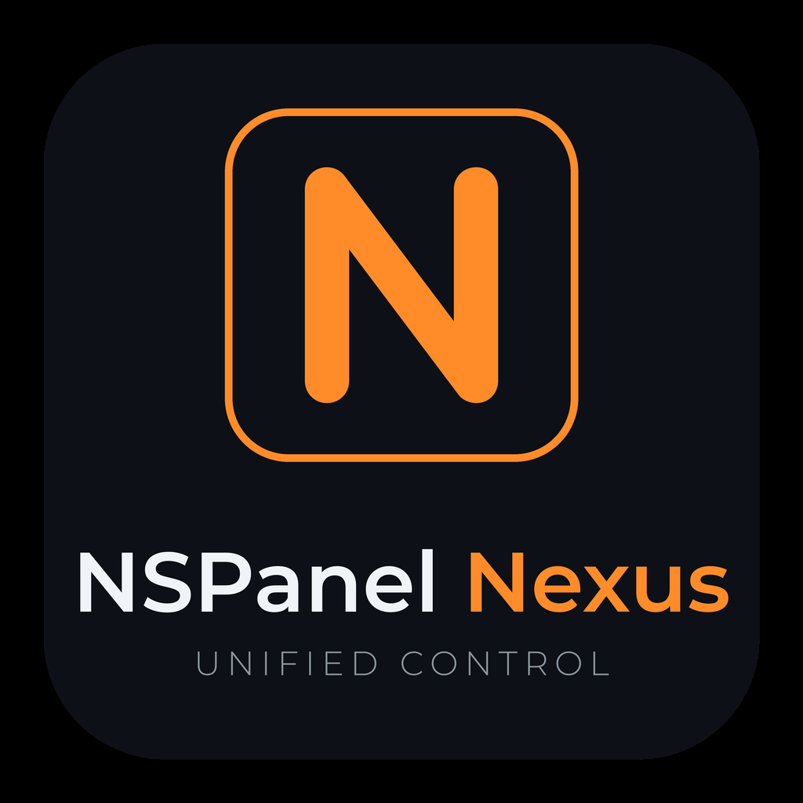

<div align="center">



# NSPanel Nexus

**Unified control plane for the Sonoff NSPanel Pro (Android) — ADB + MQTT + Home Assistant.**

One tool that aggregates the scattered NSPanel Pro ecosystem (seaky Pro Tools, kiosk-satellite,
Panel Assistant, Fully Kiosk, …) into a single, scriptable interface.

[](LICENSE)
[](pyproject.toml)
[](https://github.com/ALeXXBody/NSPanelNexus/actions/workflows/ci.yml)

</div>

---

## Why Nexus?

The NSPanel Pro is an Android tablet in a wall-switch shell. Unlike the classic
NSPanel (ESP32 + TFT), there is no single "firmware" — control is spread across
ADB, MQTT (seaky Pro Tools), HTTP (zigbee2mqtt), and Home Assistant discovery.
Nexus wraps all of that into one CLI + Python library so you can script a panel,
manage many panels, and stop juggling five different tools.

> **Nexus is a host-side control plane**, not a replacement for on-panel apps.
> Install seaky Pro Tools / Panel Assistant / kiosk-satellite on the panel, then
> drive them with Nexus over ADB + MQTT.

## Features (v0.1)

- **ADB**: connect, shell, install APK, screenshot, keyevents, push/pull
- **MQTT (seaky protocol)**: wake/sleep/reboot/launcher, switches, brightness,
  hostname, config query/update
- **CLI**: `nspanel-nexus init | adb-connect | shell | install | screenshot | mqtt … | info`
- **Research docs**: hardware, rooting, firmware-version guidance, ecosystem matrix

## Install

```bash
git clone https://github.com/ALeXXBody/NSPanelNexus.git
cd NSPanelNexus
pip install -e .
nspanel-nexus init   # configure your panel
```

See [docs/INSTALL.md](docs/INSTALL.md) and [docs/ADB_SETUP.md](docs/ADB_SETUP.md).

## Quick start

```bash
nspanel-nexus adb-connect
nspanel-nexus info
nspanel-nexus mqtt wake
nspanel-nexus mqtt brightness 80
nspanel-nexus mqtt switch switch_1 on
nspanel-nexus screenshot -o panel.png
```

## Research

- [NSPanel Pro hardware & rooting](research/NSPANEL_PRO_HARDWARE.md)
- [Ecosystem & feature matrix](research/ECOSYSTEM.md)
- [Feature matrix (Nexus vs. sources)](research/FEATURE_MATRIX.md)
- [MQTT command reference](docs/MQTT_COMMANDS.md)
- [Roadmap](docs/ROADMAP.md)

## Related projects

- [seaky/nspanel_pro_tools_apk](https://github.com/seaky/nspanel_pro_tools_apk) — reference on-panel tool
- [seaky/nspanel_pro_roottool_apk](https://github.com/seaky/nspanel_pro_roottool_apk) — OTA re-flasher
- [jxlarrea/kiosk-satellite](https://github.com/jxlarrea/kiosk-satellite) — HA kiosk + voice
- [panel-assistant](https://github.com/panel-assistant/android) — HA-managed panel app
- [ALeXXBody/NSPanelCore](https://github.com/ALeXXBody/NSPanelCore) — the non-Pro (classic NSPanel) sibling

## License

MIT. See [LICENSE](LICENSE).
